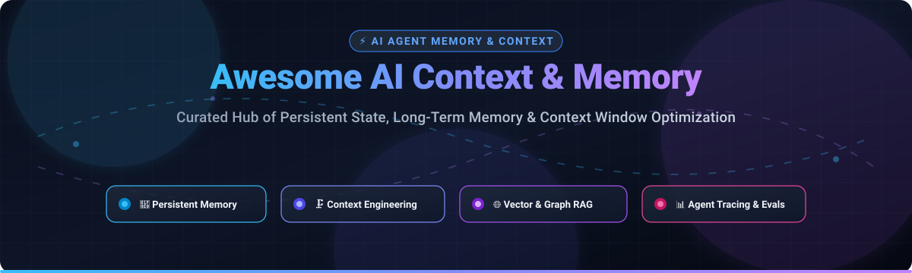

  

# Awesome AI Context & Memory 🧠⚡

  
  
  
  
  
  
  

---

## 🌟 Overview & SEO Summary 🔍

> **A curated, authoritative directory of SaaS platforms, vector stores, long-term memory systems, and open-source GitHub projects designed for Autonomous AI Agents, LLM Context Window Optimization, Session Continuity, and Agentic Workflow Architecture.**

Modern LLMs face severe operational challenges known as **"context rot"** and **attention saturation** when executing multi-turn tool loops, processing vast codebases, or sustaining long conversations. The **Awesome AI Context & Memory** ecosystem aggregates leading engineering solutions across:

- 🧠 **Persistent Agent Memory:** Entity extraction, associative graph memory, temporal reasoning, and multi-tier user/session state.
- 🗜️ **Context Window Optimization:** Sandboxed execution, prompt compaction, KV-cache compression, and semantic offloading.
- 🔍 **Vector Databases & Hybrid Retrieval:** High-performance dense kNN, sparse BM25, and metadata-filtered search engines.
- 📊 **LLM Observability & Tracing:** Full-trace lifecycle inspection, latency tracking, token spend auditing, and evaluation datasets.

---

## 📑 Table of Contents
- [📊 Sector Overview & Market Dynamics](#-sector-overview--market-dynamics)
- [🏢 SaaS & Hosted Platforms](#-saas--hosted-platforms)
- [💻 Open-Source GitHub Projects](#-open-source-github-projects)
- [🤝 How to Contribute](#-how-to-contribute)
- [☕ Support](#-support)
- [📈 Star History](#-star-history)
- [⚖️ Disclaimer](#-disclaimer)

---

## 📊 Sector Overview & Market Dynamics

The AI Context and Memory ecosystem represents a foundational layer of the agentic AI stack, currently spanning dedicated vector retrieval engines and agent memory layers:

- **Market Size & Trajectory:** The global Vector Database and AI memory software infrastructure market is estimated at **$2.5B–$3.1B in 2025–2026** and projected to surge past **$7.3B by 2030 (23.7% CAGR)**, fueled by exponential enterprise adoption of autonomous reasoning agents, agentic RAG, and long-horizon tool execution.
- **Market Dynamics & Fragmentation:** The sector is **moderately fragmented yet rapidly consolidating**, transitioning from early exploratory startups toward high-gravity hubs. While hyperscalers and established database vendors (Microsoft Azure, ClickHouse, Dynatrace) are actively acquiring or integrating memory layers, pure-play specialized innovators continue driving rapid advancements in open-source context compaction, KV-cache pruning, and associative graph persistence.

---

## 🏢 SaaS & Hosted Platforms

| Product | Valuation / Revenue | Starting Paid Price | Free Tier Limits | Key Highlights & Architecture |
| :--- | :--- | :--- | :--- | :--- |
| **[GitHub Copilot Enterprise](https://github.com/features/copilot)** | **>$7.5B valuation implied** (Microsoft acquired GitHub for $7.5B; Copilot revenue now exceeds pre-acquisition GitHub) | **$39 / user / month** | **30-day trial via Enterprise Cloud** (Copilot seats require enterprise evaluation/pilot program agreement) | Enterprise AI coding assistant with repository-wide context awareness, custom organization knowledge bases, and team workflow memory. |
| **[LangSmith](https://smith.langchain.com/)** | **$1.25B valuation** ($125M Series B led by IVP; unicorn status) | **$39 / seat / month** (Plus plan, includes 10,000 base traces/mo) | **Free forever Developer Plan**: 1 seat, **5,000 base traces / month** hard cap, 14-day data retention | LangChain's observability and evaluation platform with detailed tracing of LLM chains, agent execution graphs, latency, and token cost. |
| **[Arize Phoenix / AX](https://phoenix.arize.com/)** | **$915M valuation** (Acquired by Dynatrace in Aug 2026 for $915M cash & stock) | **$50 / month** (AX Pro plan, 50,000 spans/mo, 10 GB storage) | **AX Free Plan**: **25,000 spans / month**, **1 GB storage**, 15-day retention, unlimited human annotations | OpenTelemetry-native LLM evaluation, span-level RAG debugging, and tracing engine with self-hosted open-source or fully managed cloud. |
| **[Pinecone](https://www.pinecone.io/)** | **$750M valuation** ($100M Series B led by a16z; $130M+ total funding) | **$20 / month** (Builder tier, 10 GB storage, 5M WUs, 2M RUs) | **Starter Free Plan**: **2 GB storage (~300,000 vectors)**, 2M Write Units/mo, 1M Read Units/mo, up to 5 serverless indexes | Production-grade managed serverless vector database engineered for sub-millisecond retrieval, hybrid dense/sparse search, and enterprise metadata filtering. |
| **[Qdrant Cloud](https://qdrant.tech/)** | **~$220M valuation** ($28M Series A led by Spark Capital; $50M Series B) | **~$25 / month** (Standard consumption tier; metered per vCPU/RAM hour) | **Free Forever Cluster**: **1 GB RAM (~1,000,000 vectors with quantization)**, 0.5 vCPU, 4 GB storage, single-node | Rust-powered vector database engine supporting payload filtering, on-disk payload storage, and quantization. |
| **[Weaviate Cloud](https://weaviate.io/)** | **$200M valuation** ($50M Series B led by Index Ventures) | **$45 / month** (Flex pay-as-you-go minimum tier) | **Free Forever Sandbox**: **100,000 objects/vectors**, 1 GB RAM, 10 GB disk, 2,000 embedding reqs/day, 1,000 agent queries/mo | Modular AI-native vector database offering native vectorizer integrations, hybrid vector-BM25 search, and multi-tenant memory clustering. |
| **[Chroma Cloud](https://www.trychroma.com/)** | **$75M valuation** ($18M seed led by Quiet Capital) | **Usage-based post-credits** ($2.50/GiB written, $0.33/GiB storage, $0.0075/TiB queried) | **Starter Free Plan**: **$5 in free usage credits**, up to 10 databases, and up to 10 team member seats | Developer-first AI database optimized for local python embedding workflows, transitionable to serverless distributed cloud. |
| **[Langfuse](https://langfuse.com/)** | **Part of ClickHouse** (Acquired by ClickHouse Jan 2026; ClickHouse valued at $15B Series D) | **$29 / month** (Core plan, includes 100,000 units/mo, unlimited seats) | **Hobby Free Plan**: **50,000 units / month**, 30-day retention, up to 2 team members | Open-source LLM engineering and observability platform with prompt management, playground evaluators, and session context tracking. |
| **[Mem0 Platform](https://mem0.ai/)** | **$24M funding** (Series A led by Basis Set Ventures, Peak XV, Y Combinator) | **$19 / month** (Starter plan, 50,000 memory adds & 5,000 retrievals/mo) | **Hobby Free Plan**: **10,000 memory add requests / month** and **1,000 retrieval requests / month** | Managed adaptive memory layer with multi-level scoping (User, Session, Agent), temporal graph reasoning, and LOCOMO-validated accuracy. |
| **[Zep Cloud](https://www.getzep.com/)** | **Seed-backed** (Y Combinator, Engineering Capital, Root Ventures) | **$125 / month** (Flex plan, 50,000 credits/mo, 600 req/min) | **Free Prototyping Plan**: **10,000 credits / month**, unmetered raw memory recall & user entities | Managed agent memory infrastructure featuring automated conversation fact extraction, dialog classification, and dynamic knowledge graph generation. |

---

## 💻 Open-Source GitHub Projects

Curated list of open-source frameworks, memory engines, and context optimization projects sorted by GitHub star count (descending):

| Project | Stars | License | Description & Context Architecture |
| :--- | :--- | :--- | :--- |
| **[LangChain](https://github.com/langchain-ai/langchain)** |  | MIT | **147,000+ stars**. Foundational framework for developing applications powered by language models, including modular conversation memory stores, context buffering, and tool integration. |
| **[RAGFlow](https://github.com/infiniflow/ragflow)** |  | Apache-2.0 | **92,000+ stars**. Open-source RAG engine based on deep document understanding, grounded citation extraction, and structured context window hydration for complex agent queries. |
| **[Mem0](https://github.com/mem0ai/mem0)** |  | Apache-2.0 | **67,000+ stars**. The memory layer for personalized AI. Delivers 92.5 on LoCoMo benchmarks (+21 over baseline), entity linking, multi-signal retrieval (semantic + BM25), and MCP server integration. |
| **[AutoGen](https://github.com/microsoft/autogen)** |  | MIT | **61,000+ stars**. Microsoft's multi-agent conversational framework featuring conversational memory management, human-in-the-loop intervention, and modular context-partitioned agent swarms. |
| **[CrewAI](https://github.com/crewAIInc/crewAI)** |  | MIT | **59,000+ stars**. Framework for orchestrating role-playing autonomous AI agents, equipped with native short-term, long-term, and entity memory systems. |
| **[LlamaIndex](https://github.com/run-llama/llama_index)** |  | MIT | **52,000+ stars**. Data framework for LLM applications providing hierarchical indexing, query engines, and conversation memory managers for structured and unstructured context. |
| **[Milvus](https://github.com/milvus-io/milvus)** |  | Apache-2.0 | **46,000+ stars**. Cloud-native open-source vector database built for massive-scale similarity search, powering long-term enterprise memory layers across billions of vectors. |
| **[LangGraph](https://github.com/langchain-ai/langgraph)** |  | MIT | **43,000+ stars**. Graph-based orchestration library with built-in persistent checkpointing, time-travel debugging, and multi-agent memory state management. |
| **[Agno (formerly Phidata)](https://github.com/phidatahq/phidata)** |  | MIT | **42,000+ stars**. Lightweight multi-modal agent framework with built-in PostgreSQL session storage, vector database memory, and instant contextual recall. |
| **[Langfuse](https://github.com/langfuse/langfuse)** |  | MIT | **35,000+ stars**. Open-source LLM engineering platform offering end-to-end tracing, evaluations, prompt versioning, and context inspection. |
| **[Qdrant Engine](https://github.com/qdrant/qdrant)** |  | Apache-2.0 | **35,000+ stars**. High-performance Rust vector search engine with payload filtering, memory-efficient quantization, and scalable distributed indexing. |
| **[DeepAgents](https://github.com/langchain-ai/deepagents)** |  | MIT | **30,000+ stars**. Agent harness with context engineering middleware: tool result offloading, automatic compaction, skill injection, and long-term memory across sessions. |
| **[context-mode](https://github.com/mksglu/context-mode)** |  | Apache-2.0 | **29,000+ stars**. Open-source context optimization framework for coding agents. Delivers **98% tool output reduction** via sandboxing, SQLite snapshots, and pre-compaction state persistence. |
| **[Chroma](https://github.com/chroma-core/chroma)** |  | Apache-2.0 | **29,000+ stars**. Open-source embedding database for AI application prototyping, seamless local collection storage, and agent document filtering. |
| **[Letta (MemGPT)](https://github.com/letta-ai/letta)** |  | Apache-2.0 | **25,000+ stars**. Memory-augmented LLM operating system inspired by OS paging. Manages working context (RAM) and archival storage (disk) to enable perpetual agent state. |
| **[pgvector](https://github.com/pgvector/pgvector)** |  | PostgreSQL | **23,000+ stars**. Vector similarity search for PostgreSQL. Powers relational-plus-vector agent memory architectures without introducing a standalone database service. |
| **[Anthropic Quickstarts](https://github.com/anthropics/anthropic-quickstarts)** |  | MIT | **18,000+ stars**. Official reference architectures including contextual retrieval, customer-facing memory patterns, and prompt caching implementations. |
| **[Weaviate Engine](https://github.com/weaviate/weaviate)** |  | BSD-3-Clause | **16,000+ stars**. Open-source vector database supporting multi-modal vector search, automatic inverted indexing, and hybrid semantic retrieval. |
| **[Arize Phoenix](https://github.com/Arize-ai/phoenix)** |  | Apache-2.0 | **11,000+ stars**. AI observability platform for tracing agent invocations, tracking hallucination evals, and pinpointing context retrieval errors. |
| **[Zep Community (Legacy)](https://github.com/getzep/zep)** |  | Apache-2.0 | **4,900+ stars**. Historical open-source fast memory store for conversational AI agents. (Legacy engine archived; active development continues on Zep Cloud). |
| **[graymatter](https://github.com/angelnicolasc/graymatter)** |  | MIT | **480+ stars**. Memory and knowledge graph layer written in Go for coding agents. Provides 7 MCP tools and visual graph inspection (`graymatter kg render`). |
| **[engrim](https://pypi.org/project/engrim/)** |  | MIT | **Python Package**. Cross-platform persistent memory for coding assistants with provenance tracking, MCP server (`engrim_recall`, `engrim_add`), and 90% token reduction across 100 sessions. |
| **[TurboAgent](https://pypi.org/project/turboagent-ai/)** |  | MIT | **Python Package**. Agentic framework utilizing TurboQuant KV-cache compression for long-context LLMs, unlocking 32k-1M+ effective context on consumer GPUs. |
| **[montycat](https://pub.dev/packages/montycat)** |  | MIT | **Dart/Flutter Package**. Self-hosted Rust-powered NoSQL and vector store with on-device embeddings, reciprocal-rank fusion, and zero egress overhead. |

---

## 🤝 How to Contribute

We welcome contributions from researchers, platform architects, and open-source maintainers! 🚀

1. 🍴 **Fork** the repository.
2. 🌿 Create a feature branch: `git checkout -b feature/add-new-tool`.
3. 📝 Add or update entries in [README.md](file:///C:/Users/ishan/Documents/Projects/Awesome-AI-Context-Memory/README.md).
   - Ensure SaaS entries include verified pricing and free tier specs.
   - Ensure open-source additions include clean architecture summaries, social star badges, and links to official repositories.
4. 📬 Submit a Pull Request with a clear description of why the tool belongs in the list.

---

## ☕ Support

If you found this curated list helpful for building your AI systems or agent infrastructure:
- ⭐ **Star** this repository to help other developers discover it!
- 🍴 **Fork** and share it with your engineering team and community.
- ☕ **Sponsor & Buy a Coffee:** You can support the ongoing curation and maintenance of this list via the [GitHub Sponsors Dashboard](https://github.com/sponsors/ishandutta2007). Your support is greatly appreciated! ❤️

---

## 📈 Star History

---

## ⚖️ Disclaimer

- This is an **independently maintained, community-curated** catalog — inclusion does not represent an endorsement or commercial partnership.
- **Privacy & Compliance:** Persistent agent memory stores ingest dialogue, codebase snippets, and user actions. Implement proper retention policies, encryption at rest, and access controls compliant with regulations such as GDPR, HIPAA, and CCPA.
- **Context Rot Prevention:** Mitigating context window pollution requires combining proactive prevention (sandboxing code, offloading large tool payloads) and adaptive filtering (KV-cache quantization, associative entity graphs).
- Product pricing and free tier quotas are subject to vendor updates. Always check official vendor portals for live contractual details.
